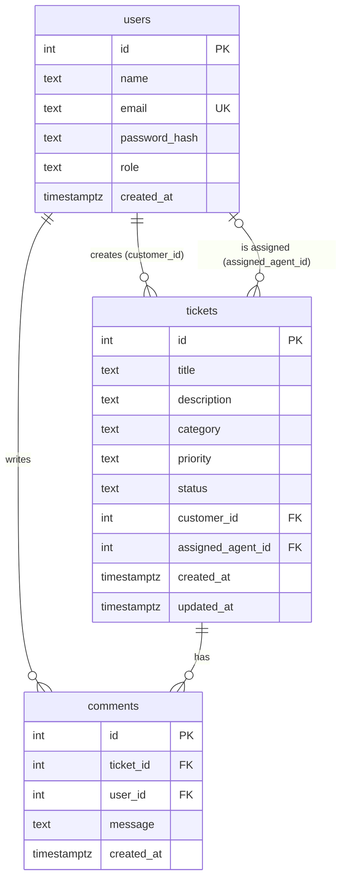

# MiniDesk Database Guide

MiniDesk stores its data in PostgreSQL, in three related tables. The definitions are in [schema.sql](../database/schema.sql), and sample data is in [seed.sql](../database/seed.sql).

## Set it up

1. Make sure PostgreSQL is running.
2. In `backend/.env`, set `DB_PASSWORD`, and `DB_PORT` if yours isn't 5432.
3. Run:

```bash
cd backend
npm run db:reset
```

This creates the `minidesk` database if needed, and rebuilds its tables and sample data.

**Warning:** `db:reset` deletes all data in that database. It refuses to run when `NODE_ENV` is `production`.

## Sample accounts

All of them use the password `MiniDesk-Demo-2026`. These are for local development only, because the password is public.

| Email | Role |
|---|---|
| `admin@example.com` | Admin |
| `sam@example.com`, `maya@example.com` | Agent |
| `priya@example.com`, `liam@example.com`, `noah@example.com` | Customer |

## ER diagram



## How the tables relate

| Relationship | Type | What happens on delete |
|---|---|---|
| A customer creates tickets | One-to-many | `RESTRICT`: a customer who has tickets can't be deleted |
| An agent is assigned tickets | One-to-many, optional | `SET NULL`: their tickets become unassigned |
| A ticket has comments | One-to-many | `CASCADE`: deleting a ticket deletes its comments |
| A user writes comments | One-to-many | `RESTRICT`: a user who has comments can't be deleted |

`tickets` points to `users` twice, so ticket queries join `users` twice, under the names `customer` and `agent`.

## Data rules

The database enforces these itself, so bad data is refused even if the application has a bug.

- **`CHECK`:** allowed values for role, category, priority and status, plus text lengths and lowercase emails.
- **`UNIQUE`:** no two users can share an email.
- **`NOT NULL`:** required fields must have a value. Only `assigned_agent_id` can be empty.
- **`FOREIGN KEY`:** a ticket can't point to a user who doesn't exist.

## Indexes

| Index | Speeds up |
|---|---|
| `users.email` (from `UNIQUE`) | Login |
| `tickets.status`, `tickets.priority` | Filters |
| `tickets.customer_id` | A customer's own tickets |
| `tickets.assigned_agent_id` | An agent's own tickets |
| `tickets.created_at` | Sorting newest first |
| `comments.ticket_id` | Loading a ticket's comments |

Searching titles with `ILIKE '%text%'` can't use a normal index. That's fine at this size, and a larger app would use PostgreSQL's full-text search or a trigram index.

## Main queries

### Tickets with both people's names

From [ticketService.ts](../backend/src/services/ticketService.ts):

```sql
SELECT t.id, t.title, customer.name AS "customerName", agent.name AS "assignedAgentName"
FROM tickets t
JOIN users customer ON customer.id = t.customer_id
LEFT JOIN users agent ON agent.id = t.assigned_agent_id;
```

`LEFT JOIN` keeps tickets with no agent. A plain `JOIN` would silently hide them.

### Dashboard counts

From [dashboardService.ts](../backend/src/services/dashboardService.ts):

```sql
SELECT
  COUNT(*)::int AS total,
  COUNT(*) FILTER (WHERE status = 'open')::int AS open
FROM tickets;
```

One query calculates all the numbers, instead of one query for each.

## Try it

Open `psql`, or pgAdmin, and connect to the `minidesk` database. Your port depends on which server you chose:

```bash
psql -h localhost -p 5432 -U postgres -d minidesk
```

```sql
SELECT * FROM tickets WHERE status = 'open';
SELECT u.name, COUNT(t.id) AS tickets FROM users u JOIN tickets t ON t.customer_id = u.id GROUP BY u.name;
EXPLAIN SELECT * FROM tickets WHERE customer_id = 4;
```
