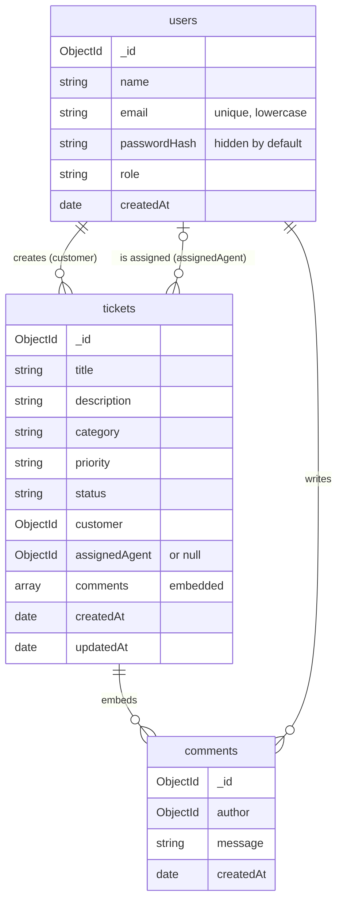

# MiniDesk Database Guide

MiniDesk stores its data in MongoDB, using Mongoose. The schemas are in [backend/src/models](../backend/src/models), and the sample data is in [sampleData.ts](../backend/src/scripts/sampleData.ts).

The project was first built on PostgreSQL. That version is saved under the Git tag `postgres-version`, and its SQL is in [examples/postgresql](../examples/postgresql/README.md).

## Set it up

1. Make sure MongoDB is running.
2. In `backend/.env`, set `MONGODB_URI`, for example `mongodb://localhost:27017/minidesk`.
3. Run:

```bash
cd backend
npm run db:reset
```

This loads the sample data into that database.

**Warning:** `db:reset` deletes all users and tickets in that database. It refuses to run when `NODE_ENV` is `production`, and on any database whose name doesn't start with `minidesk`, so other projects on the same server are safe.

## Sample accounts

All of them use the password `MiniDesk-Demo-2026`. These are for local development only, because the password is public.

| Email | Role |
|---|---|
| `admin@example.com` | Admin |
| `sam@example.com`, `maya@example.com` | Agent |
| `priya@example.com`, `liam@example.com`, `noah@example.com` | Customer |

## Collections



A ticket looks like this in the database:

```json
{
  "_id": "000000000000000000001006",
  "title": "App crashes when uploading a file",
  "status": "in_progress",
  "priority": "high",
  "customer": "000000000000000000000004",
  "assignedAgent": "000000000000000000000003",
  "comments": [
    { "_id": "...", "author": "000000000000000000000004", "message": "It happens every time..." }
  ]
}
```

## Why it's designed this way

| Data | Design | Reason |
|---|---|---|
| Comments | Embedded in the ticket | They belong to one ticket and are read with it. Deleting a ticket removes them automatically |
| Customer and agent | Referenced by ID | Users are shared by many tickets. A changed name updates everywhere |

## Rules

Mongoose schemas enforce these before saving:

- **Required fields**, and allowed values with `enum` for role, category, priority and status.
- **Text lengths** for names, titles, descriptions and comments.
- **Lowercase emails.**

The **unique index** on `email` is enforced by MongoDB itself.

**What the database doesn't enforce:** unlike SQL foreign keys, MongoDB doesn't check that a ticket's `customer` or `assignedAgent` exists. The API checks this in its services. MiniDesk has no way to delete users, so references can't be left dangling.

## Indexes

| Index | Speeds up |
|---|---|
| `users.email` (unique) | Login |
| `tickets.status`, `tickets.priority` | Filters |
| `tickets.customer` | A customer's own tickets |
| `tickets.assignedAgent` | An agent's own tickets |
| `tickets.createdAt`, `tickets.updatedAt` | Sorting |

Searching titles with a case-insensitive pattern can't use a normal index well. That's fine at this size, and a larger app would use a text index or Atlas Search.

## Main queries

### Tickets with both people's names

From [ticketService.ts](../backend/src/services/ticketService.ts):

```ts
TicketModel.find(filter).select('-comments').sort({ createdAt: -1 }).populate(PEOPLE)
```

`populate` replaces each stored user ID with that user's name and email.

### Dashboard counts

From [dashboardService.ts](../backend/src/services/dashboardService.ts): one aggregation pipeline, with `$match`, then `$group` using `$sum` and `$cond`, calculates all four numbers.

## Try it

In **MongoDB Compass**, or `mongosh`, connect to `mongodb://localhost:27017`, and open the `minidesk` database.

```js
use minidesk
db.tickets.find({ status: 'open' })
db.tickets.countDocuments({ priority: 'high' })
db.tickets.aggregate([{ $group: { _id: '$status', count: { $sum: 1 } } }])
db.tickets.find({ status: 'open' }).explain('executionStats')
```
